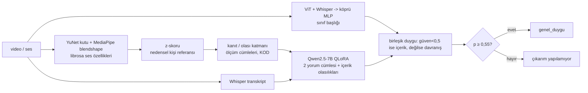

# davranis-analizi

Video/ses penceresinde **ölçülen** yüz ve ses göstergelerini listeleyen, her göstergenin yaygın anlamını temkinli bir dille yazan ve söylenen içerikle birlikte genel bir duygu dağılımı veren çok kipli model (v2.1.1).

> **Yalan tespiti, kişilik testi ya da duygu "okuma" aracı DEĞİLDİR.** Yüz/ses iddiaları ölçüm dilindedir ("ölçümde kaş indirme belirgin (kanıt), z=…"). Araştırma / ticari olmayan kullanım içindir.
> Çıtaların çoğu karşılanmadı (aşağıdaki tablo); model kartı sınırları ayrıntılı anlatır: [MODEL_CARD.md](MODEL_CARD.md).

## Bağlantılar
| | |
|---|---|
| HF model (ağırlıklar + kod; **kapılı erişim**, manuel onay) | https://huggingface.co/akadirgok/davranis-v2-1-1 |
| HF Space (demo) | https://huggingface.co/spaces/akadirgok/davranis-v2-1-1-demo |
| Kaggle Model | özel (Kaggle'da kapılı erişim yok; ağırlıklar HF'de kapılı erişimle) |

Ağırlıklar FER2013, AffectNet, RAF-DB, MELD, CMU-MOSEI, CREMA-D ve RAVDESS ile eğitilmiş bileşenler içerir; bu veri setlerinin koşulları ayrıca geçerlidir (hukuki görüş değildir).

## Mimari

Kod katmanı (ölçüm, katman ataması, ölçüm cümlesi, anlam/alternatif sözlüğü, güven kuralı) LLM'e bırakılmaz; LLM yalnızca iki yorum cümlesi ve içerik duygusu olasılığını üretir.

## Sonuçlar (test; v2 / v2.1 / v2.1.1 aynı örnekler; %95 bootstrap)
| ölçüt | çıta | v2.1 | v2.1.1 | durum |
|---|---|---|---|---|
| MELD w-F1 (`genel_duygu`) | ≥0,55 | 0,490 | 0,483 [0,446; 0,517] | KALDI |
| MELD seçici doğruluk | >0,489 | 0,496 | 0,490 (kapsama 0,818) | GEÇTİ (sınırda) |
| MOSEI Acc-2 zorunlu (taban 0,701) | ≥0,75 | 0,653 | 0,656 [0,620; 0,690] | KALDI |
| MUStARD++ uyumsuz kesinliği | ≥0,70 | kapalı | kapalı (dev AUC 0,499) | KALDI |
| Kapalı sinyal ihlali | 0 | 1386/4972 | 0/4972 | GEÇTİ |
| Kanıt tam (oyunculu) | ≥%15 | %16,2 | %10,0 [7,9; 12,1] | KALDI |
| İşaretli (oyunculu) | ≥%50 | %25,8 | %61,9 | GEÇTİ (çoğu "olası") |

### RAVDESS sağlık testi (n=4, Actor_04, eğitimde görülmemiş; yalnız akıl sağlığı)
| etiket | davranış duygusu | içerik duygusu | birleşik |
|---|---|---|---|
| mutlu | Şaşkınlık 0,58 ✗ | Şaşkınlık 0,56 | Şaşkınlık 0,58 ✗ |
| kızgın | **Öfke 0,68** ✓ | Şaşkınlık 0,54 | **Öfke 0,68** ✓ |
| üzgün | çıkarım yapılamıyor (0,26) | Nötr 1,00 | Nötr 1,00 ✗ (içerik davranışı bastırdı) |
| şaşkın | **Şaşkınlık 0,94** ✓ | Şaşkınlık 0,55 | **Şaşkınlık 0,94** ✓ |

Sabit cümleli kayıtlarda söz nötrdür; birleşik değerlendirme nötre kayabilir, davranış duygusuna bakın. Ayrıntı: [MODEL_CARD.md](MODEL_CARD.md).

Duygu doğruluğu v2.1'e göre iyileşmedi; v2.1.1'in kazanımı ölçüm katmanının dürüstlüğüdür (kapalı sinyal 0, tutarlılık 0, nedensel referans).

## Kurulum ve kullanım
Ağırlıklar bu depoda yoktur (`agirliklar/` .gitignore'da); HF model deposundan indirin ve `agirliklar/` altına koyun.
```bash
pip install -r requirements.txt
python cikarim_v211.py --medya klip.mp4 --yalniz-olcum        # CPU: ölçüm cümleleri + kural tabanlı yorum
python cikarim_v211.py --medya klip.mp4 --cikti sonuc.json    # tam hat (GPU; Qwen2.5-7B nf4 + Whisper)
python -m unittest discover -s testler                        # birim testleri (ağırlık gerekmez)
```
Demo uygulaması: [`space/`](space/) (Gradio, ZeroGPU).

## Kullanım dışı
İşe alım/değerlendirme, kredi/sigorta, adli süreç, güvenlik/gözetim, kimlik tanıma, yalan/niyet tespiti, sağlık teşhisi, rızasız izleme.

## Lisanslar
- **Kod:** MIT ([LICENSE](LICENSE)).
- **Ağırlıklar ve model çıktıları:** CC BY-NC-SA 4.0 ([LICENSE-WEIGHTS](LICENSE-WEIGHTS)).
- Eğitim verisi koşulları (MELD, CMU-MOSEI, CREMA-D, RAVDESS) ayrıca geçerlidir; bu bir hukuki görüş değildir.
- `yapilandirma/referans_populasyon.json`: MELD train'den türetilmiş toplu özet istatistik; ham veri içermez.
